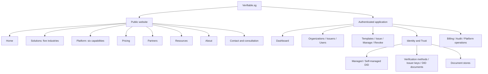

# Verifiable.sg CaaS experience redesign

## 1. Audit and direction

The existing product already provides organization governance, issuer-specific signing,
managed/customer-hosted DIDs, credential lifecycle operations and subscription controls.
The discovery experience does not yet explain that infrastructure clearly.

Evidence from the initial 28-route inventory:

| Surface | Evidence and adoption barrier | Direction |
|---|---|---|
| Home | `app/page.tsx:15`: branded-credential headline; visitors sent to gated operations | Lead with trust, lifecycle and organization identity; demo/consultation CTAs |
| Navigation | `lib/navigation.ts:11`: Home labelled Platform; shared operations menu | Separate marketing and workspace navigation; permission-gate actions |
| Admin | `app/platform/page.tsx:8`: private operations occupies requested public URL | Move operations to `/platform/dashboard`, retain server permission check |
| Dashboard | `app/dashboard/page.tsx:44`: loaded-record summary, not lifetime metrics | Preserve honest scope; add organization capacity and operational entry points |
| Pricing | `app/enterprise/page.tsx:72`: established prices and commercial terms | Canonical `/pricing`, preserve `/enterprise`; frame organizational growth |
| Identity | `app/organization-did/page.tsx:6`: capabilities hidden behind DID terminology | Dedicated Identity & Trust hub and deep links to existing tools |
| Contact | `app/contact/page.tsx:21`: empty operator fields | Remove empty display fields; legal operator details remain a launch dependency |
| Issuance | `app/insurance/page.tsx:691`: several labels lack associated controls | Retain working issuance; full form accessibility remediation needs dedicated testing |
| Templates | `app/templates/builder/page.tsx:346`: labels without control association | Retain builder; track field-by-field accessibility follow-up |
| Verification | `app/verification/page.tsx` vs `app/verify/page.tsx` | Keep inspector explicitly distinct from signature/status verification |
| Footer | `components/Footer.tsx:6`: limited discovery links | Capabilities, resources, legal and sales paths |
| Shared styles | `app/globals.css:131`: broad transitions | Color transitions, visible focus, reduced motion and responsive layouts |
| Authentication | `app/issuer/page.tsx:103`: sign-in/reset/invitation workflow | Preserve existing account policy; do not invent public self-registration |

Other inventoried surfaces: organizations, admin issuers/users, billing, audit,
profile, branding gallery, document stores, legacy DID, revocation, wallet/delivery,
batch preview, renderer, user/admin manuals, release notes, privacy and terms.
These remain operational URLs. This is an IA/content review, not certification of
every form, third-party viewer or end-to-end assistive-technology workflow.

## 2. Information architecture

## 3. Sitemap and page inventory

- `/`: exact approved headline, lifecycle, capabilities, audiences and pricing.
- `/solutions`: training-providers, professional-associations, universities,
  corporate-learning, certification-bodies.
- `/platform`: organization-management, issuer-management, credential-management,
  digital-identity, verification, security.
- `/pricing`: approved plans; `/enterprise` remains supported.
- `/partners`: prospective ecosystem, not a claim of existing partnerships.
- `/resources`: faqs, case-studies, documentation, blog, whitepapers.
  Unpublished resources are explicitly marked planned, never fabricated.
- `/about`: Verifiable.sg as an independent Credential-as-a-Service platform.
- `/contact`: demo, consultation, sales and support, using the existing mailbox.
- `/verify`: existing public verifier, unchanged.
- Existing application routes remain; `/platform/dashboard` replaces the previous
  private `/platform` entry by explicit product-owner approval.

## 4. Role-based navigation

| Role | Primary paths |
|---|---|
| Platform admin | Dashboard, Organizations, Issuers, Credentials, Identity & Trust, Verification, Administration |
| Organization admin | Dashboard, Issuers, Templates, Credentials, Identity & Trust, Users, Audit Logs; billing under administration |
| Issuer | Dashboard, Issue Credential, Credentials, Verification, Profile |
| Viewer | Dashboard, Credentials, Verification, Profile; no mutation actions |

Issuer-membership permissions remain authoritative alongside organization roles.
Navigation never replaces API authorization. Organization administrators do not gain
issuance rights merely from the redesign. Advanced workflows remain linked from
credential and identity hubs instead of filling primary navigation.

## 5. Design system and refactor plan

Reuse the installed Next.js Link/router, Tailwind utilities, Lucide icons and existing
card/button/form styles. No new UI framework, dependency or paid service is needed.
Refactor the central navigation model, NavBar, SiteChrome, Footer, marketing page
composition and dashboard summary. Reuse DID, key, billing and store panels rather
than creating parallel administration logic.

Use restrained slate/cyan surfaces, readable line lengths, responsive card grids,
tabular numbers, explicit loading/error/empty states and one primary action per
section. Preserve certificate-paper styles and cryptographic services.

## 6. Phased migration and validation

1. Navigation: relocate private platform page, update protection and role menus.
   Gate: navigation, session and proxy tests plus production type/build validation.
2. Public website: add meaningful capability/industry pages and metadata.
   Gate: route/content/link inventory and production build.
3. Dashboard: reuse scoped APIs; retain truthful loaded-record counts.
   Gate: role/error/loading tests and build.
4. Identity & Trust: organize existing workflows and deep links.
   Gate: permission/navigation tests and existing identity suites.
5. Conversion: mailbox-backed demo/consultation paths, footer, SEO and mobile checks.
   Gate: browser desktop/mobile checks, production build and full-suite comparison.

No remote migration, key generation, blockchain transaction, payment integration,
deployment or authentication-policy change is part of this redesign.

## 7. SEO plan

Unique titles/descriptions and canonical public URLs; sitemap limited to public
discovery pages; robots exclude workspace/admin routes. Preserve old URLs.
Use digital credentials, credential management, Credential-as-a-Service,
credential infrastructure, professional certifications, membership credentials and
digital credential platform in relevant editorial context, not keyword stuffing.
Do not index private tenant records or fabricate review/customer structured data.

## 8. Accessibility

Retain skip link, visible focus, Escape dismissal/focus restoration, real navigation
links, semantic headings, touch targets, responsive tables and reduced motion.
New pages use labelled landmarks and readable dark/light surfaces. Validate at
mobile width and keyboard navigation. Outstanding legacy form-label and legal
operator-information gaps above prevent a blanket WCAG/production-readiness claim.

## 9. Mockups and trust content

Implementation uses a dark trust-led hero, a five-stage lifecycle diagram, capability
and industry cards, growth-stage pricing and a dedicated identity hub. These are
live layouts, not fabricated customer screenshots. No invented testimonials,
customer logos, compliance badges, partner endorsements or guaranteed verification
claims. Browser validation results are recorded below.

## 10. Implementation and validation results

- Phase 1: role navigation, separate public/workspace primary navigation, protected
  admin relocation. 13 focused tests and production build passed.
- Phase 2: public catalog, five industry pages, six capability pages, five resource
  pages, About, Partners and canonical Pricing. 18 focused tests and build passed.
- Phase 3: separate credential catalogue and dashboard summaries using session/RLS
  counts, explicit tenant filters, private/no-store responses and existing scoped
  subscription/identity/store APIs. 16 focused tests and build passed.
- Phase 4: Identity & Trust hub and stable DID section anchors, reusing existing
  key/DID/store workflows. 30 focused navigation/identity tests and build passed.
- Phase 5: demo/consultation/sales mailbox paths, expanded footer, sitemap, robots
  and workspace noindex headers. Existing hosting function budget retained by
  registering the summary handler through the consolidated business API.
- No invented usage or healthy-state fallbacks. Dashboard revocations mean
  currently revoked credentials, not all historical revocation events; verification
  volume means recorded linked checks, not people. Platform-wide financial totals
  remain platform-admin-only.

  The final focused acceptance suite passes 55 tests. Production compilation and
  TypeScript validation pass. The full suite passes 477 of 492 tests; the same
  15 named failures were present in the 478-test baseline, with no new failing names.
  Browser JavaScript chunks contain none of the scanned server-service/private-key
  markers. Shared dark primary-button colors now meet the measured 4.5:1 normal-text
  contrast threshold in default and hover states.

Browser checks used a local production server with synthetic Supabase configuration,
not a real customer session. The homepage had no horizontal overflow at 320, 390,
768, 1024, 1280 and 1440 CSS pixels. Desktop screenshots show the two-column trust
hero and public navigation; mobile screenshots show stacked CTAs and a compact
menu. Mobile pricing was checked in dark mode with all three growth stages and
a locally scrollable comparison table. Escape closed the menu and restored trigger
focus; keyboard focus remained visible. The demo CTA reached the labelled contact
section below the sticky header, with the correct email subject and canonical URL.
All 26 public routes checked returned HTTP 200, including the legacy pricing URL.
Unknown catalog slugs render Next.js's not-found page with noindex; with the current
streaming root layout, that response can have HTTP 200 rather than 404. Private
dashboard, identity and credential routes redirect anonymous users to login, the
summary API returns 401, and sitemap/robots endpoints return 200.

Authenticated dashboard role/loading/error behavior is covered by rendered tests;
no live tenant, email delivery, checkout, chain transaction or comprehensive
screen-reader/WCAG certification was exercised. Existing legacy form accessibility
and unpublished legal operator details remain documented follow-up work.
